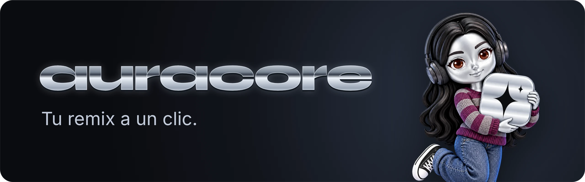
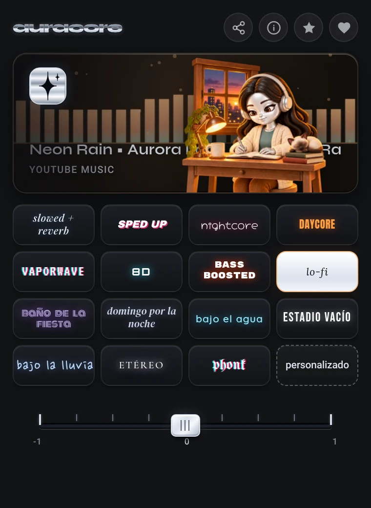

  

  <a href="README.md">English</a> · <a href="README.pt-BR.md">Português</a> · <b>Español</b>

  <a href="#instalación">Instalación</a> ·
  <a href="#los-estilos">Los estilos</a> ·
  <a href="#conoce-a-arabot">Conoce a arabot</a> ·
  <a href="PRIVACY.md#español">Privacidad</a> ·
  <a href="#apoyo">Apoyo</a>

  
  
  
  
  
  

Slowed + reverb, nightcore, lo-fi y 12 estilos de remix más en cualquier canción, sin esperar a que alguien suba esa versión. auracore aplica el remix en vivo, directamente en tu navegador, sobre lo que ya estás escuchando.

auracore es una extensión para Chrome y Firefox. Elige un estilo y el audio de la pestaña cambia al instante: en YouTube, YouTube Music, Spotify, Deezer, SoundCloud y otros reproductores.

  

## Qué hace

- 15 estilos de remix, cada uno en versión suave, estándar e intensa.
- Un panel personalizado con todos los controles: velocidad, graves, tono, saturación, cinta, chorus, vinilo, reverb, sala, 8D, lluvia y agua. Guarda tus propios estilos.
- Una pestaña a la vez: el efecto suena solo donde lo activaste, así que una clase o una llamada en otra pestaña mantiene su sonido normal.
- Una escena animada para cada estilo, con un visualizador que sigue tu música y la canción que suena en el escenario.
- Fade al final de la canción y tape stop al pausar.
- Interfaz en español, inglés y portugués de Brasil, según el idioma del navegador.
- Todo se procesa en tu dispositivo. Sin cuenta, sin rastreo, nada se graba.

## Los estilos

<table>
  <tr>
    <td align="center" width="50%"> <b>slowed + reverb</b> Más lento y grave, con una cola de reverb suave.</td>
    <td align="center" width="50%"> <b>sped up</b> Más rápido y brillante.</td>
  </tr>
  <tr>
    <td align="center"> <b>nightcore</b> Rápido, agudo y con más pegada.</td>
    <td align="center"> <b>daycore</b> Más lento y cálido, como una tarde tranquila.</td>
  </tr>
  <tr>
    <td align="center"> <b>vaporwave</b> Lento, con chorus y bañado en una sala enorme.</td>
    <td align="center"> <b>8D</b> El sonido gira alrededor de tu cabeza. Usa audífonos.</td>
  </tr>
  <tr>
    <td align="center"> <b>bass boosted</b> Graves potentes, sin saturar gracias a un limitador.</td>
    <td align="center"> <b>lo-fi</b> Cinta que ondula, saturación cálida y un poco de vinilo.</td>
  </tr>
  <tr>
    <td align="center"> <b>baño de la fiesta</b> La canción sonando al otro lado de la puerta.</td>
    <td align="center"> <b>domingo por la noche</b> La canción del vecino a lo lejos, soñadora y nostálgica.</td>
  </tr>
  <tr>
    <td align="center"> <b>bajo el agua</b> Apagado, con el agua a tu alrededor.</td>
    <td align="center"> <b>estadio vacío</b> Un salón enorme sin nadie dentro.</td>
  </tr>
  <tr>
    <td align="center"> <b>bajo la lluvia</b> Lluvia y truenos lejanos debajo de la música.</td>
    <td align="center"> <b>etéreo</b> Flotando en un reverb largo y suave.</td>
  </tr>
  <tr>
    <td align="center"> <b>phonk</b> Un poco más rápido, con graves potentes y saturación.</td>
    <td align="center"> <b>personalizado</b> Todos los controles, tu propia receta.</td>
  </tr>
</table>

## Conoce a arabot

arabot es la cara de auracore: una pequeña figura de cromo líquido, con cabello negro largo y ondulado, ojos marrones y pecas. Cambia de ropa y de escenario en cada estilo. En lo-fi estudia en su escritorio junto a una gatita siamesa, en el baño de la fiesta se retoca el labial frente a un espejo neón, bajo la lluvia abre los brazos a la tormenta y en etéreo flota.

Mientras la música suena, se mueve con ella: respira, se balancea o da saltitos según el estilo. Apaga auracore y ella descansa en la oscuridad hasta que vuelvas.

 

## Requisitos

- Chrome 116 o superior, o Firefox 128 o superior. Otros navegadores no se han probado.
- Node.js 22 o superior, solo para ejecutar las pruebas.

## Instalación

auracore se envió a la Chrome Web Store y a addons.mozilla.org el 24 de octubre de 2026 y está en revisión. Hasta que se apruebe, instálalo desde este repositorio:

1. Descarga o clona el repositorio.
2. Abre `chrome://extensions` y activa el Modo de desarrollador.
3. Haz clic en Cargar descomprimida y selecciona la carpeta del repositorio.

En Firefox: ejecuta `npm run package`, abre `about:debugging#/runtime/this-firefox`, haz clic en Cargar complemento temporal y elige `dist/auracore-firefox.zip`. Firefox quita los complementos temporales al cerrarse.

## Uso

1. Reproduce música en una pestaña: YouTube, YouTube Music, Spotify, Deezer, SoundCloud y otros reproductores.
2. Haz clic en el icono de auracore y elige un estilo. Al hacer clic de nuevo en el estilo activo, se apaga.
3. El control debajo de los estilos hace el efecto más suave o más intenso. En 8D elige la trayectoria: círculo, libre u ocho.
4. Personalizado abre todos los controles y permite guardar tus propios estilos.

auracore funciona en una pestaña a la vez. Abrir el popup en otra pestaña y elegir un estilo lleva el efecto allí; las demás pestañas mantienen su sonido original.

## Configuración

El estilo, la intensidad, el fade, el tape stop y los estilos guardados se almacenan en `chrome.storage.local`; la pestaña activa se guarda en `chrome.storage.session`. El audio se procesa en tu dispositivo y nunca se graba ni se envía a ningún lado. Los detalles están en la [política de privacidad](PRIVACY.md#español).

## Limitaciones

- En servicios con reproducción protegida, como Spotify y Amazon Music, los efectos pasan por la captura de pestaña de Chrome, que muestra un indicador de captura mientras el efecto está activo. Detener la captura desde ese indicador apaga auracore en esa pestaña.
- Firefox no tiene captura de pestaña, así que en esos servicios solo cambian la velocidad y el tono; los demás efectos necesitan Chrome.
- auracore se ejecuta en todos los sitios para encontrar reproductores que empiezan antes de abrir el popup. Puedes limitar el acceso por sitio en `chrome://extensions` → auracore → Detalles.
- Safari no es compatible.

## Desarrollo

`npm test` ejecuta las pruebas, sin dependencias que instalar. `npm run package` genera `dist/auracore.zip` para Chrome y Edge y `dist/auracore-firefox.zip` para Firefox. La documentación para desarrollo está en portugués: [ARCHITECTURE.md](ARCHITECTURE.md), [TESTING.md](TESTING.md) y [ROADMAP.md](ROADMAP.md).

## Apoyo

auracore es gratuito y seguirá siéndolo. Lo desarrollo en mis ratos libres, entre el trabajo y la universidad. Si ya acompaña tu música, ¿qué tal invitarme un cafecito en Ko-fi, una vez o cada mes? También puedes patrocinarme en GitHub. Y si no puedes, no pasa nada: recomendarlo a un amigo o dejar una estrella en el repositorio ya me alegra el día.

  

## Licencia y créditos

El código es visible, pero todos los derechos están reservados: puedes leerlo e instalar auracore para uso personal, no redistribuirlo. Consulta la [LICENSE](LICENSE), en inglés.

El arte de arabot y los sonidos de ambiente fueron generados con IA y editados por mí. Las fuentes están bajo la SIL Open Font License, en `fonts/licenses/`.
