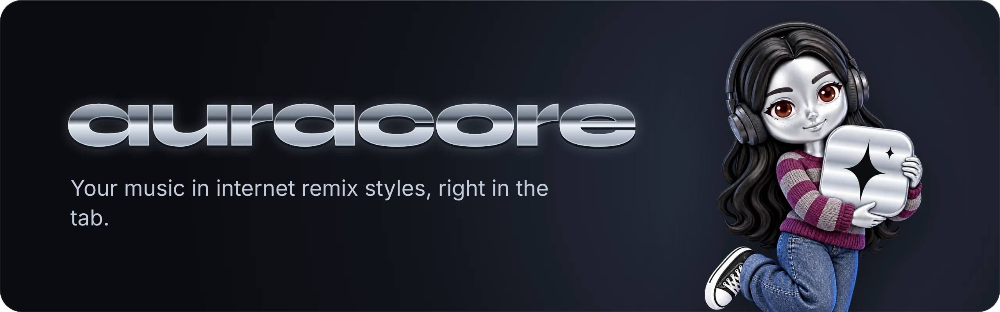

  

  <b>English</b> · <a href="README.pt-BR.md">Português</a> · <a href="README.es.md">Español</a>

  <a href="#installation">Installation</a> ·
  <a href="#the-styles">The styles</a> ·
  <a href="#meet-arabot">Meet arabot</a> ·
  <a href="PRIVACY.md">Privacy</a> ·
  <a href="#support">Support</a>

  
  
  
  
  

Slowed + reverb, nightcore, lo-fi and 12 more remix styles on any song, without waiting for someone to upload that version. auracore applies the remix live, right in your browser, to whatever you are already listening to.

auracore is an extension for Chrome and Edge. Pick a style and the tab's audio changes on the spot: on YouTube, YouTube Music, Spotify, Deezer, SoundCloud and other players.

  
  

  

## What it does

- 15 remix styles, each with a soft, standard and intense version.
- A custom panel with every control: speed, bass, pitch, saturation, tape, chorus, vinyl, reverb, room, 8D, rain and water. Save your own styles.
- One tab at a time: the effect plays only where you turned it on, so a class or a call in another tab keeps its normal sound.
- An animated scene for every style, with a visualizer that follows your music and the track playing on the stage.
- Fade at the end of the song and a tape stop when you pause.
- Interface in English, Spanish and Brazilian Portuguese, following your browser language.
- Everything is processed on your device. No account, no tracking, nothing recorded.

## The styles

<table>
  <tr>
    <td align="center" width="50%"> <b>slowed + reverb</b> Slower and deeper, with a soft reverb tail.</td>
    <td align="center" width="50%"> <b>sped up</b> Faster and brighter.</td>
  </tr>
  <tr>
    <td align="center"> <b>nightcore</b> Fast and high-pitched, with extra punch.</td>
    <td align="center"> <b>daycore</b> Slowed down and warm, like a lazy afternoon.</td>
  </tr>
  <tr>
    <td align="center"> <b>vaporwave</b> Slow, chorused and washed in a big room.</td>
    <td align="center"> <b>8D</b> The sound circles around your head. Use headphones.</td>
  </tr>
  <tr>
    <td align="center"> <b>bass boosted</b> Heavy low end, kept clean by a limiter.</td>
    <td align="center"> <b>lo-fi</b> Tape wobble, warm saturation and a little vinyl.</td>
  </tr>
  <tr>
    <td align="center"> <b>bathroom at a party</b> The song playing on the other side of the door.</td>
    <td align="center"> <b>sunday night</b> A neighbor's song from far away, dreamy and nostalgic.</td>
  </tr>
  <tr>
    <td align="center"> <b>underwater</b> Muffled, with water all around you.</td>
    <td align="center"> <b>empty arena</b> A huge hall with nobody in it.</td>
  </tr>
  <tr>
    <td align="center"> <b>in the rain</b> Rain and distant thunder under the music.</td>
    <td align="center"> <b>ethereal</b> Floating in a long, soft reverb.</td>
  </tr>
  <tr>
    <td align="center"> <b>phonk</b> A touch faster, with heavy bass and saturation.</td>
    <td align="center"> <b>custom</b> Every control, your own recipe.</td>
  </tr>
</table>

## Meet arabot

arabot is the face of auracore: a little liquid-chrome figure with long wavy black hair, warm brown eyes and freckles. She changes outfits and scenery with every style. In lo-fi she studies at her desk next to a Siamese cat, in the party bathroom she fixes her lipstick in a neon mirror, in the rain she opens her arms to the storm, and in ethereal she floats.

While the music plays she moves with it, a little breathing, swaying or bouncing depending on the style. Turn auracore off and she rests in the dark until you come back.

 

## Requirements

- Chrome 116 or newer, or Microsoft Edge 116 or newer. Other browsers have not been tested.
- Node.js 22 or newer, only to run the tests.

## Installation

In Chrome, install auracore from the [Chrome Web Store](https://chromewebstore.google.com/detail/auracore/gdimfnfkcbhfkmopkgbkjnjbmbpbipni). In Microsoft Edge, install it from [Edge Add-ons](https://microsoftedge.microsoft.com/addons/detail/auracore/eoijcnmpkocgebbdolcipnbhgkhknmbo).

To run the code from this repository in Chrome:

1. Download or clone the repository.
2. Open `chrome://extensions` and turn on Developer mode.
3. Click Load unpacked and select the repository folder.

## Usage

1. Play music in a tab: YouTube, YouTube Music, Spotify, Deezer, SoundCloud and other players.
2. Click the auracore icon and pick a style. Clicking the active style again turns it off.
3. The slider under the styles makes the effect softer or stronger. On 8D it picks the path: circle, free or figure eight.
4. Custom opens every control and lets you save your own styles.

auracore works on one tab at a time. Opening the popup on another tab and picking a style moves it there; the other tabs keep their original sound.

## Configuration

Style, intensity, fade, tape stop and saved styles are stored in `chrome.storage.local`; the active tab is kept in `chrome.storage.session`. Audio is processed on your device and is never recorded or sent anywhere. Details are in the [privacy policy](PRIVACY.md).

## Limitations

- On services with protected playback, such as Spotify and Amazon Music, effects go through Chrome tab capture, and Chrome shows a capture indicator while the effect is on. Stopping the capture from that indicator turns auracore off on that tab.
- auracore runs on every site so it can find players that start before the popup opens. Access can be limited per site in `chrome://extensions` → auracore → Details.
- Safari is not supported.

## Development

`npm test` runs the test suite, with no dependencies to install. `npm run package` builds `dist/auracore.zip` for Chrome and Edge. Developer documentation is in Portuguese: [ARCHITECTURE.md](ARCHITECTURE.md), [TESTING.md](TESTING.md) and [ROADMAP.md](ROADMAP.md).

## Support

auracore is free and will stay that way. I work on it in my spare time, between work and college. If it has become part of your music, you can buy me a coffee on Ko-fi, once or every month, or sponsor me on GitHub. And if you can't, that's fine: telling a friend or leaving a star on the repository already makes my day.

  

## License and credits

The source code is visible, but all rights are reserved: you may read it and install auracore for personal use, not redistribute it. See [LICENSE](LICENSE).

The arabot artwork and the ambience sounds were generated with AI and edited by me. The fonts are under the SIL Open Font License, in `fonts/licenses/`.
