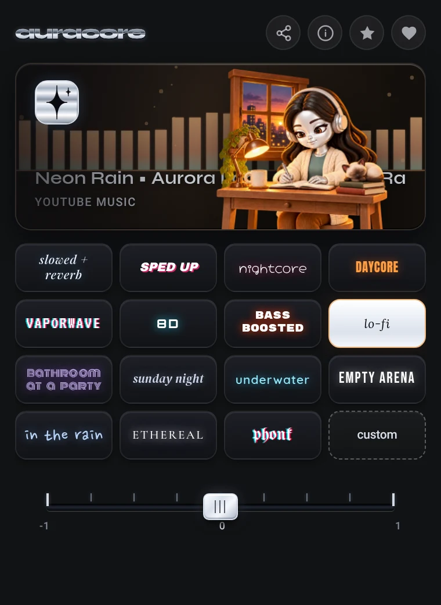

# auracore

Chrome extension that plays the audio of any tab in internet remix styles, such as slowed + reverb, nightcore, 8D and lo-fi, live while you listen.

[Português](README.pt-BR.md) · [Español](README.es.md)

  
  

## Requirements

- Chrome 116 or newer. Other Chromium-based browsers have not been tested.
- Node.js 22 or newer, only to run the tests.

## Installation

auracore is not in the Chrome Web Store yet. To install it from this repository:

1. Download or clone the repository.
2. Open `chrome://extensions` and turn on Developer mode.
3. Click Load unpacked and select the repository folder.

## Usage

1. Play music in a tab: YouTube, YouTube Music, Spotify, Deezer, SoundCloud and other players.
2. Click the auracore icon and pick a style. Clicking the active style again turns it off.
3. The slider under the styles makes the effect softer or stronger. On 8D it picks the path: circle, free or figure eight.
4. Custom opens every control (speed, bass, pitch, reverb, 8D, rain, water and more) and lets you save your own styles.

Styles: slowed + reverb, sped up, nightcore, daycore, vaporwave, 8D, bass boosted, lo-fi, bathroom at a party, sunday night, underwater, empty arena, in the rain, ethereal and phonk.

auracore works on one tab at a time. Opening the popup on another tab and picking a style moves it there; the other tabs keep their original sound. The interface follows the Chrome language: English, Spanish or Brazilian Portuguese.

## Configuration

Style, intensity, fade, tape stop and saved styles are stored in `chrome.storage.local`; the active tab is kept in `chrome.storage.session`. Audio is processed on your device and is never recorded or sent anywhere. Details are in the [privacy policy](PRIVACY.md).

## Limitations

- On services with protected playback, such as Spotify and Amazon Music, effects go through Chrome tab capture, and Chrome shows a capture indicator while the effect is on. Stopping the capture from that indicator turns auracore off on that tab.
- auracore runs on every site so it can find players that start before the popup opens. Access can be limited per site in `chrome://extensions` → auracore → Details.
- Firefox and Safari are not supported.

## Development

`npm test` runs the test suite, with no dependencies to install. `npm run package` builds `dist/auracore.zip`. Developer documentation is in Portuguese: [ARCHITECTURE.md](ARCHITECTURE.md), [TESTING.md](TESTING.md) and [ROADMAP.md](ROADMAP.md).

## Support

auracore is free. If it has become part of your music, you can buy me a coffee through [GitHub Sponsors](https://github.com/sponsors/lucaswotta). Telling a friend or starring the repository helps too.

## License and credits

The source code is visible, but all rights are reserved: you may read it and install auracore for personal use, not redistribute it. See [LICENSE](LICENSE).

The arabot artwork and the ambience sounds were generated with AI and edited by me. The fonts are under the SIL Open Font License, in `fonts/licenses/`.
