

  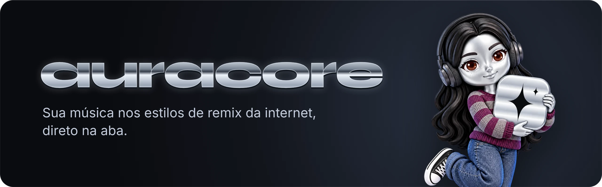

  <a href="README.md">English</a> · <b>Português</b> · <a href="README.es.md">Español</a>

  <a href="#instalação">Instalação</a> ·
  <a href="#os-estilos">Os estilos</a> ·
  <a href="#conheça-a-arabot">Conheça a arabot</a> ·
  <a href="PRIVACY.md#português">Privacidade</a> ·
  <a href="#apoio">Apoio</a>

  

Oi, eu sou o Lucas. Criei o auracore porque queria ouvir qualquer música em slowed + reverb, nightcore ou lo-fi sem depender de alguém ter subido essa versão no YouTube. Agora o remix acontece direto no seu navegador, ao vivo, no que você já está ouvindo.

O auracore é uma extensão para Chrome e Firefox. Escolha um estilo e o áudio da aba muda na hora: no YouTube, YouTube Music, Spotify, Deezer, SoundCloud e outros players.

  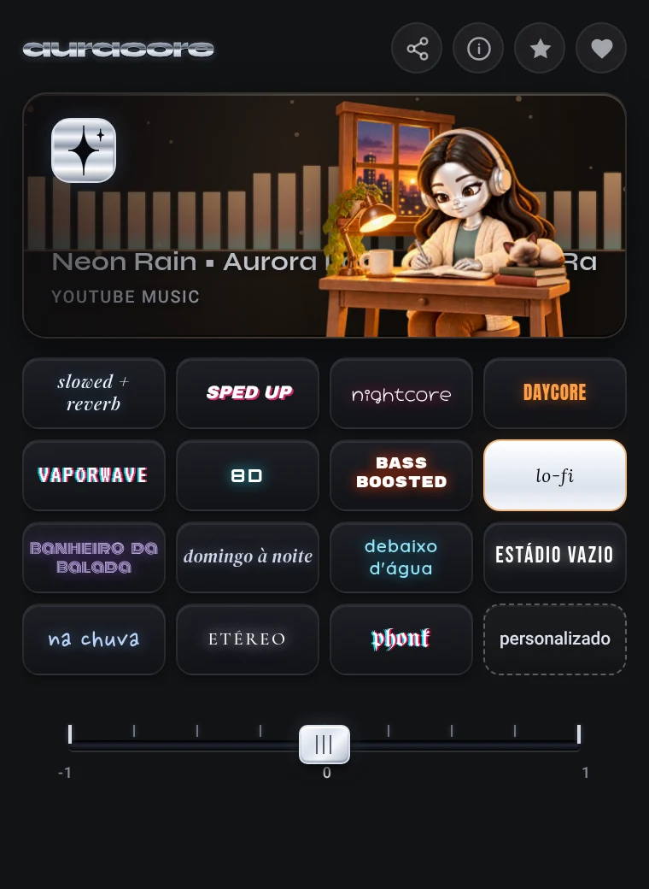

## O que ele faz

- 15 estilos de remix, cada um nas versões suave, padrão e intensa.
- Um painel personalizado com todos os controles: velocidade, graves, tom, saturação, fita, chorus, vinil, reverb, sala, 8D, chuva e água. Salve seus próprios estilos.
- Uma aba por vez: o efeito toca só onde você ligou, então a aula ou a chamada em outra aba continua com o som normal.
- Uma cena animada para cada estilo, com um visualizador que acompanha a sua música e a faixa que está tocando no palco.
- Fade no fim da música e tape stop quando você pausa.
- Interface em português do Brasil, inglês e espanhol, seguindo o idioma do navegador.
- Tudo é processado no seu dispositivo. Sem conta, sem rastreamento, nada gravado.

## Os estilos

<table>
  <tr>
    <td align="center" width="50%">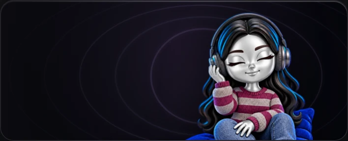 <b>slowed + reverb</b> Mais lento e grave, com uma cauda de reverb suave.</td>
    <td align="center" width="50%">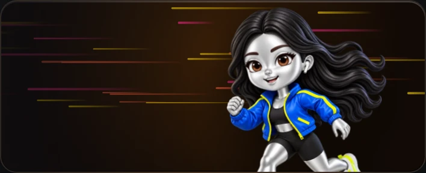 <b>sped up</b> Mais rápido e brilhante.</td>
  </tr>
  <tr>
    <td align="center">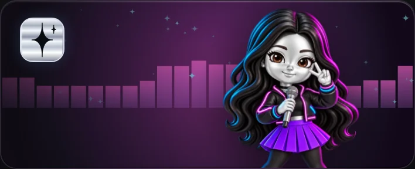 <b>nightcore</b> Rápido, agudo e com mais pegada.</td>
    <td align="center">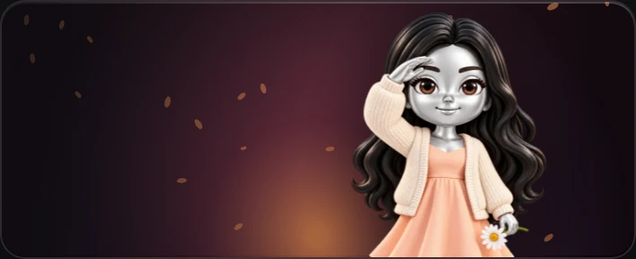 <b>daycore</b> Desacelerado e quentinho, como uma tarde preguiçosa.</td>
  </tr>
  <tr>
    <td align="center">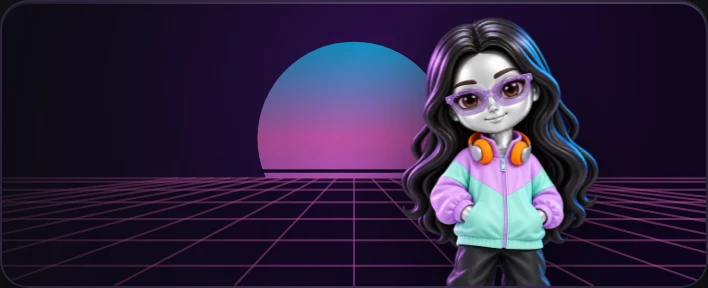 <b>vaporwave</b> Lento, com chorus e banhado numa sala enorme.</td>
    <td align="center">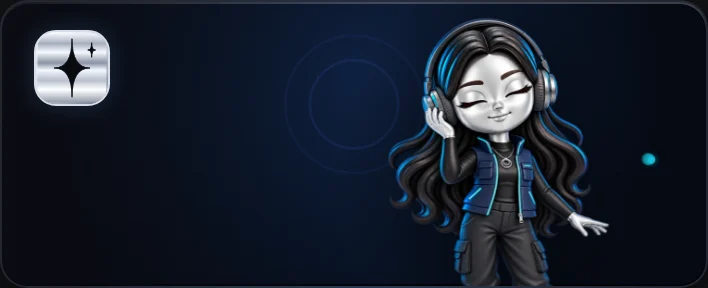 <b>8D</b> O som gira em volta da sua cabeça. Use fone.</td>
  </tr>
  <tr>
    <td align="center">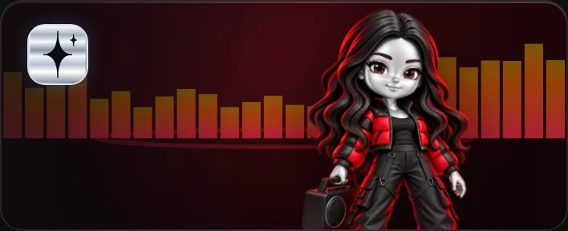 <b>bass boosted</b> Grave pesado, sem estourar, graças a um limitador.</td>
    <td align="center">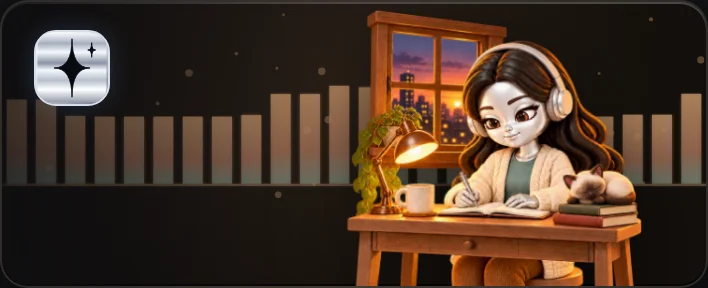 <b>lo-fi</b> Fita oscilando, saturação quente e um pouco de vinil.</td>
  </tr>
  <tr>
    <td align="center">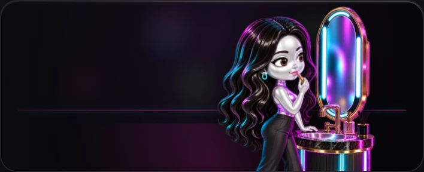 <b>banheiro da balada</b> A música tocando do outro lado da porta.</td>
    <td align="center">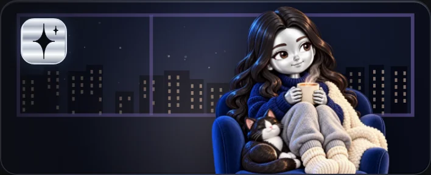 <b>domingo à noite</b> A música do vizinho lá longe, sonhadora e nostálgica.</td>
  </tr>
  <tr>
    <td align="center">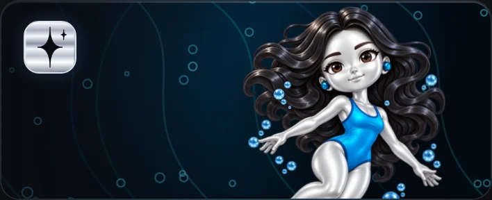 <b>debaixo d'água</b> Abafado, com a água em toda volta.</td>
    <td align="center">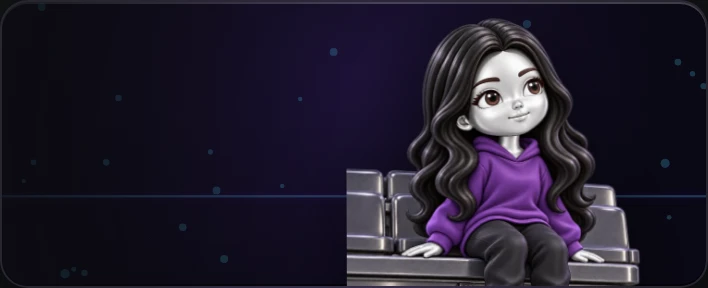 <b>estádio vazio</b> Um salão enorme sem ninguém dentro.</td>
  </tr>
  <tr>
    <td align="center">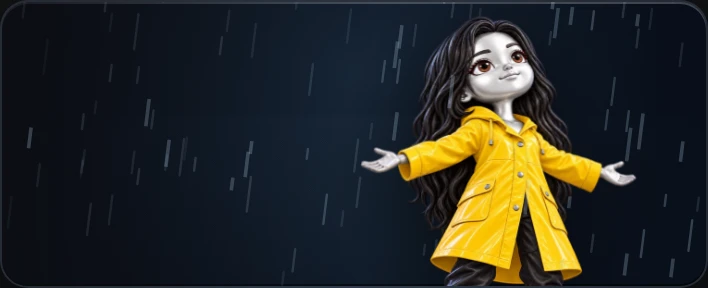 <b>na chuva</b> Chuva e trovão distante por baixo da música.</td>
    <td align="center">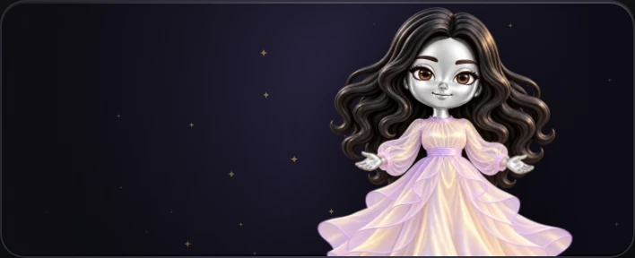 <b>etéreo</b> Flutuando num reverb longo e macio.</td>
  </tr>
  <tr>
    <td align="center">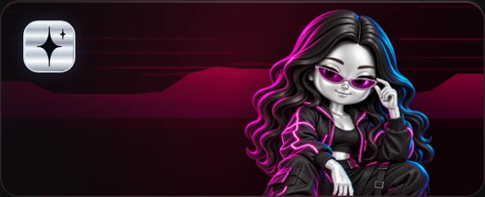 <b>phonk</b> Um pouco mais rápido, com grave pesado e saturação.</td>
    <td align="center">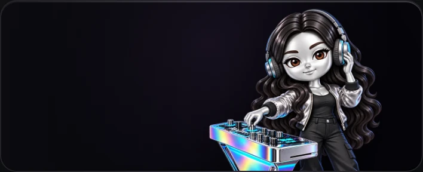 <b>personalizado</b> Todos os controles, a sua receita.</td>
  </tr>
</table>

## Conheça a arabot

A arabot é o rostinho do auracore: uma pequena figura de cromo líquido, com cabelo preto longo e ondulado, olhos castanhos e sardas. Ela troca de roupa e de cenário em cada estilo. No lo-fi estuda na escrivaninha ao lado de uma gatinha siamesa, no banheiro da balada retoca o batom num espelho neon, na chuva abre os braços para a tempestade e no etéreo flutua.

Enquanto a música toca, ela se mexe junto: respira, balança ou dá pulinhos, conforme o estilo. Desligue o auracore e ela descansa no escuro até você voltar.

 

## Requisitos

- Chrome 116 ou superior, ou Firefox 128 ou superior. Outros navegadores não foram testados.
- Node.js 22 ou superior, só para rodar os testes.

## Instalação

O auracore ainda não está na Chrome Web Store. Para instalar a partir deste repositório:

1. Baixe ou clone o repositório.
2. Abra `chrome://extensions` e ative o Modo do desenvolvedor.
3. Clique em Carregar sem compactação e selecione a pasta do repositório.

No Firefox, enquanto o auracore não está no addons.mozilla.org: rode `npm run package`, abra `about:debugging#/runtime/this-firefox`, clique em Carregar extensão temporária e escolha `dist/auracore-firefox.zip`. O Firefox remove extensões temporárias ao fechar.

## Uso

1. Toque uma música numa aba: YouTube, YouTube Music, Spotify, Deezer, SoundCloud e outros players.
2. Clique no ícone do auracore e escolha um estilo. Clicar de novo no estilo ativo desliga.
3. O controle abaixo dos estilos deixa o efeito mais suave ou mais intenso. No 8D ele escolhe o trajeto: círculo, livre ou oito.
4. Personalizado abre todos os controles e permite salvar estilos próprios.

O auracore funciona em uma aba por vez. Abrir o popup em outra aba e escolher um estilo leva o efeito para lá; as demais abas continuam com o som original.

## Configuração

Estilo, intensidade, fade, tape stop e estilos salvos ficam em `chrome.storage.local`; a aba ativa fica em `chrome.storage.session`. O áudio é processado no seu dispositivo e nunca é gravado nem enviado a lugar nenhum. Os detalhes estão na [política de privacidade](PRIVACY.md#português).

## Limitações

- Em serviços com reprodução protegida, como Spotify e Amazon Music, os efeitos passam pela captura de aba do Chrome, que mostra um indicador de captura enquanto o efeito estiver ligado. Encerrar a captura por esse indicador desliga o auracore naquela aba.
- O Firefox não tem captura de aba, então nesses serviços só a velocidade e o tom mudam nele; os outros efeitos precisam do Chrome.
- O auracore roda em todos os sites para encontrar players que começam antes de o popup abrir. Dá para limitar o acesso por site em `chrome://extensions` → auracore → Detalhes.
- Safari não é suportado.

## Desenvolvimento

`npm test` roda a suíte de testes, sem dependências para instalar. `npm run package` gera `dist/auracore.zip` para Chrome e Edge e `dist/auracore-firefox.zip` para Firefox. A documentação para desenvolvimento está em [ARCHITECTURE.md](ARCHITECTURE.md), [TESTING.md](TESTING.md) e [ROADMAP.md](ROADMAP.md).

## Apoio

O auracore é gratuito e vai continuar assim. Eu cuido dele nas horas vagas, entre o trabalho e a faculdade. Se ele já embala as suas músicas, que tal me pagar um cafezinho? Vale Pix ou GitHub Sponsors, uma vez ou todo mês. E se não der, tudo bem: indicar para um amigo ou deixar uma estrela no repositório já faz o meu dia.

  

   
  Chave Pix aleatória: <code>16a5c103-0372-42a7-8b40-0d29c2a418f0</code>

## Licença e créditos

O código é visível, mas todos os direitos são reservados: você pode ler e instalar o auracore para uso pessoal, não redistribuir. Veja a [LICENSE](LICENSE), em inglês.

A arte da arabot e os sons de ambiente foram gerados com IA e editados por mim. As fontes estão sob a SIL Open Font License, em `fonts/licenses/`.
